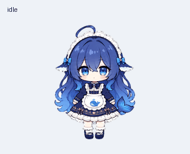
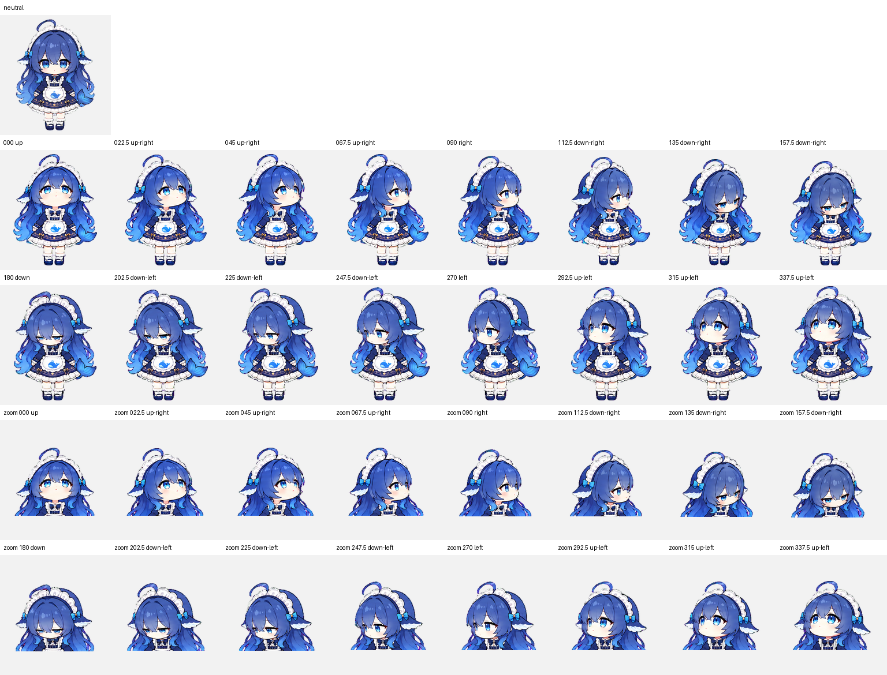

# Mira · 蓝发小鲸鱼桌面伙伴

Mira 是一套根据用户提供的角色参考图，经 AI 辅助生成并整理、验证的动画宠物素材：蓝色渐变长发、鲸鱼围裙、蕾丝头饰，以及一条小尾鳍。

## 包含什么

- [透明精灵表 PNG](assets/mira-v2.png)：1536 × 2288，v2 格式，8 列 × 11 行，每格 192 × 208。
- 九种动作：待机、向右跑、向左跑、挥手、跳跃、失败反应、等待输入、专注思考、检查。
- 十六个视线方向，共 73 个有效帧。
- [MP4 动画预览](previews/all-states.mp4)和[视线循环](previews/look-loop.gif)。

## 如何使用

下载 `assets/mira-v2.png`，在支持该 v2 格式的宠物客户端中导入。不同客户端的导入入口及兼容性可能不同；本仓库是素材包，不是独立运行的桌宠程序。

这套素材已通过结构和质量检查，并已创建为 ChatGPT Work 自定义宠物。桌面浮窗的显示依赖客户端功能和设置，本仓库不保证所有版本都能显示。

## 制作说明

角色参考图由用户提供，图像与动画帧使用 AI 辅助生成，再进行透明处理、排版和验证；不是手绘作品。接近垂直的三个斜向视线变化较细微，已保留在素材中。

## 权利说明

原始参考图的作者和授权范围尚未核实。本仓库不声称拥有原始角色的独占版权，也不额外授予角色美术的商业使用或再分发许可。使用者应自行确认所需授权。

